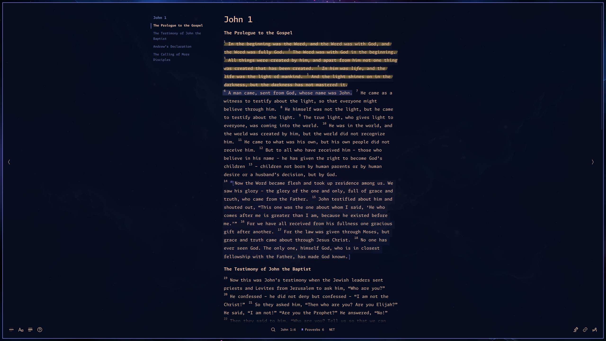
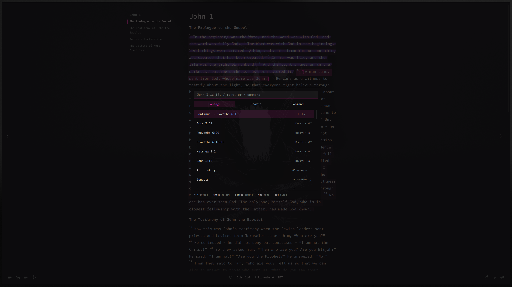
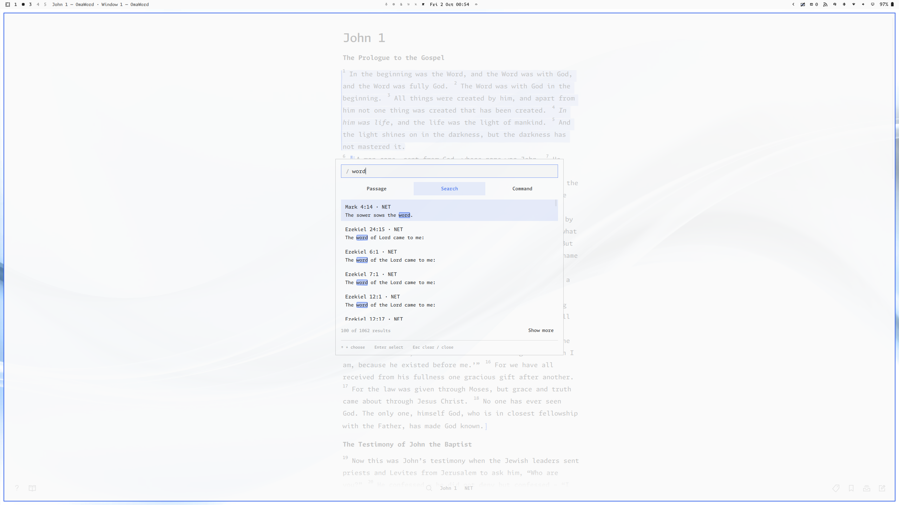

# OmaWord

[](https://github.com/tcballard/omarchy-badges)

A minimal, keyboard-first Bible reader built with Qt Quick and C++ that follows your Omarchy theme, system font, and desktop corners. Read offline, bookmark, highlight, and tag passages, and keep Markdown notes alongside the text.



## Install

OmaWord is built for [Omarchy](https://omarchy.org) and assumes its Hyprland session, theme files, and fonts. Other desktops are not supported.

```sh
sudo pacman -S --needed base-devel qt6-declarative libarchive libpipewire
git clone https://github.com/bradenr402/omaword.git
cd omaword
bin/build
bin/install
```

Launch **OmaWord** from your application launcher or run `omaword`. To update, `git pull` and run `bin/build` and `bin/install` again. `bin/install` keeps the files it replaces from one previous install in `~/.local/state/omaword/previous-install`.

To install it as an Arch package instead (to `/usr`, managed by pacman), build the recipe in `packaging/`; it builds the latest commit on GitHub:

```sh
cd packaging
makepkg -si
```

## Bible versions

Choose **Add version** to install NET, KJV, KJV with Apocrypha, OJB, YLT, ASV, or BSB directly from eBible.org. Each version's card says what it is, its year, download size, and license, and what it carries (footnotes, section headings, words of Jesus, the Apocrypha); the download's progress shows in its card. You can also import a local USFM ZIP.

Internet is needed only to download a version. Once installed, reading and annotations work offline, and the original ZIP is no longer needed. Bible text has its own copyright and attribution, shown in About & Attribution.

## Screenshots

The palette navigates to passages, searches Scripture, and runs commands:



OmaWord follows your Omarchy theme, colors, and fonts:



## Shortcuts

<!-- shortcuts:start -->

Press `?` in the app for the full, searchable list; `enter` there performs the selected action.
Generated from the action catalog by `bin/shortcuts`; alternatives are separated by ·.

### Navigate

- `k` · `↑`: Previous verse
- `j` · `↓`: Next verse
- `4j`: Repeat a verse motion by a count
- `20g`: Go to verse number
- `g` · `home`: Select chapter beginning
- `shift G` · `end`: Select chapter end
- `ctrl u`: Previous 5 verses
- `ctrl d`: Next 5 verses
- `ctrl b` · `pgup`: Previous 10 verses
- `ctrl f` · `pgdn`: Next 10 verses
- `zz`: Center current verse
- `zt`: Scroll current verse to top
- `zb`: Scroll current verse to bottom
- `h` · `←`: Previous chapter
- `l` · `→`: Next chapter
- `{`: Previous heading or chapter top
- `}`: Next section heading

### History

- `[`: Back to the previous jump
- `]` · `mouse forward`: Forward to the next jump
- `-`: Swap with the previous jump
- `mouse back`: Back a jump, back to the palette's books, or close the open panel

### Select

- `click`: Select verse
- `shift click`: Select a range
- `shift V`: Toggle visual selection
- `v`: Select characters (Vim charwise visual)
- `h` · `l`: Characters: left, right (across verses)
- `w` · `b` · `e` · `ge`: Characters: by word
- `shift W` · `shift B` · `shift E`: Characters: by WORD (no spaces)
- `(` · `)`: Characters: by sentence
- `j` · `k`: Characters: by line
- `0` · `^` · `$`: Characters: line start, first ink, end
- `gg` · `shift G`: Characters: chapter start, end
- `iw` · `aw` · `is` · `as`: Characters: word, sentence objects
- `o`: Characters: swap ends
- `y` · `ctrl c`: Characters: copy quotation
- `shift Y` · `ctrl shift C`: Characters: copy plain text
- `esc`: Characters: leave
- `shift J` · `shift ↓`: Extend to next verse
- `shift K` · `shift ↑`: Extend to previous verse

### Search

- `/`: Find in chapter
- `n`: Next search match
- `shift N`: Previous search match
- `ctrl /`: Search Bible
- `ctrl ↓` · `ctrl ↑`: Bible search: next book, previous book

### Annotate

- `m`: Bookmark selection
- `x`: Highlight selection
- `w`: Write a note
- `t`: Tag passage
- `d`: Add to Desk
- `shift E`: Edit the selection's annotation range
- `backspace`: Edit range: choose another overlapping range
- `esc`: Edit range: back from Combine notes to moving the range
- `ctrl t`: Manage tags
- `enter`: Manage tags: rename the chosen tag
- `delete`: Manage tags: delete a tag
- `ctrl m`: Manage tags: choose a tag to merge into
- `backspace`: Manage tags: back to the picker (empty filter)
- `[[`: Suggest a passage to link (in a note)
- `alt enter`: Open the passage or web link at the cursor (in a note)
- `ctrl click`: Open the passage or web link clicked (in a note)
- `alt v`: Switch a note between Write and Preview (Notes panel)
- `ctrl s`: Note changed in another window: save my draft (in a note)
- `ctrl shift S`: Note changed in another window: use the saved text (in a note)
- `ctrl ↓`: From a note to its Linked from list (esc returns)

### Copy

- `y` · `middle click`: Copy passage as quotation
- `ctrl c`: Copy selected text as quotation (else the passage)
- `shift Y`: Copy passage as plain text
- `ctrl shift C`: Copy selected text as plain text (else the passage)
- `menu` · `shift F10` · `right click`: Open context menu

### Panels

- `shift A`: Annotations panel
- `shift D`: Open Desk
- `shift S`: Study panel

### Palettes and windows

- `ctrl k`: Navigate to a passage
- `ctrl h`: History
- `ctrl space`: Open commands
- `space`: Resume last palette
- `ctrl ,`: Reading settings
- `ctrl v`: Switch version
- `?`: Keybindings
- `ctrl n`: New window
- `ctrl i`: Add version from Versions
- `enter`: Add version: install the highlighted version
- `shift enter`: Add version: its Details & Attribution
- `ctrl i`: Add version: import a USFM ZIP
- `backspace`: Back a step in Remove version (Versions)
- `ctrl shift I`: Re-import the highlighted version (Versions)
- `delete`: History: remove a passage
- `shift delete`: History: clear it

### Reading

- `f`: Focus mode
- `alt n`: Show verse numbers
- `alt h`: Show headings
- `alt o`: Chapter outline
- `alt w`: Margin notes
- `alt j`: Highlight words of Jesus
- `alt l`: Layout
- `alt s`: Sound effects
- `alt m`: Animations
- `ctrl =`: Larger text
- `ctrl -`: Smaller text
- `ctrl 0`: Reset text size
- `ctrl alt =`: Increase line height
- `ctrl alt -`: Decrease line height
- `ctrl alt 0`: Reset line height
- `esc`: Dismiss current panel or selection

### Lists

- `j` · `↓`: Next item
- `k` · `↑`: Previous item
- `g` · `home`: First item
- `shift G` · `end`: Last item
- `ctrl d`: Down 5 items
- `ctrl u`: Up 5 items
- `ctrl f` · `pgdn`: Down 10 items
- `ctrl b` · `pgup`: Up 10 items
- `enter`: Open item
- `y`: Copy item as quotation
- `shift Y`: Copy item as plain text
- `d`: Add item to Desk, or remove it
- `shift E`: Edit item's annotation range (Annotations, Study's Tags)
- `delete` · `backspace`: Remove item
- `t`: Edit the item's tags (Annotations and Study Tags)
- `tab` · `shift tab`: Between Study Tags results and tag chips
- `space`: Turn a Study tag chip on or off
- `shift space`: Show only this tag (a Study tag chip), or all tags again
- `0`: Show all tags (Study tag chips)
- `a`: Study Tags in all installed versions, or this one
- `/`: Search the list (Annotations tabs with more than 10 items, Study's Tags)
- `h` · `←`: Previous tab (Annotations, Study)
- `l` · `→`: Next tab (Annotations, Study)
- `shift delete` · `shift backspace`: Clean Desk

### Commands only

- Add version
- Remove version
- Export notes as Markdown
- Save annotation backup
- Restore annotation backup
- Clear History
- Disable / Enable History
- About & Attribution

### Aliases

These also work, but stay out of the in-app list:

- `20G` (Go to verse number): Vim's go-to-line.
- `ctrl shift P` (Open commands): the command palette key in VS Code and its kin.
- `F1` (Keybindings): the help key in most desktop apps.
- `ctrl +` (Larger text): the zoom-in key in most apps (shift = on many layouts).

<!-- shortcuts:end -->

## Features

### Reading
- Paragraph, Verse, and Block layouts (`alt l`, or Reading settings → Layout), with optional verse numbers and headings.
- Focus mode (`f`) dims everything but the current verse and keeps it 40% down the window, like a typewriter. The footer then shows only the focus button; rest the pointer on it (or tab to it) to reveal the rest in place.
- **Highlight words of Jesus** (`alt j`) colors them with your theme's palette, where the version marks them (KJV).
- Wide windows add margins: a sticky **Chapter outline** of the chapter and its section headings on the left (`alt o`; `{` / `}` jump between headings, `{` ending at the top of the chapter), and **Margin notes** on the right (`alt w`), each joined to its passage by hand-drawn braces and an arrow. Margin notes take priority and may move the text left; both are off by default.

### Finding passages
- The passage palette understands compact references like `jn316`, `1co13`, or `rev 3 14-22`, and lists likely matches, best first. Choosing a book (`enter` or `→`) shows its chapters as a grid of numbers, five to a row: arrows move, typing a number narrows the grid, `3:16` goes to that verse, and `backspace` returns to the books.
- Search Scripture across the current version: results come in Bible order under each book's name and count, and `ctrl ↓` / `ctrl ↑` jump between books. Or find in the current chapter (`/`) with a regular expression, Neovim-style smart case: lowercase ignores case, any capital matches it, `\c` / `\C` force either way.
- Click the chapter title for the book's chapter grid, the current chapter chosen; the `<` `>` buttons at the window's edges step chapters (`h` `l`).
- `[` and `]` (or the mouse's back and forward buttons) step back and forward through the passages you jumped to in this window; `-` swaps with the previous one.
- History keeps the passages you stayed on for a few seconds, shared by every window. The passage palette lists the latest five above the books, then **All History**; `ctrl h` opens it directly: newest first under Today, Yesterday, and Earlier, typing narrows it, `delete` removes a passage and `shift delete` clears it. It never goes into backups, and Commands can clear or disable it.

### Studying
- Bookmark, highlight, tag, and write Markdown notes; notes save when you pause typing, and before you move on. `alt v` switches a note between Write and Preview; the editor keeps the keyboard (`tab` types a tab, `ctrl ↓` reaches Linked from).
- In a note, `[[` suggests passages and inserts the full reference. Exact references such as `John 3:16` become links (`alt enter` or `ctrl click` follows one, or opens a web address), and Notes lists the other notes that link to a passage.
- Quote part of a passage: `v` selects characters with Vim motions (`w`, `e`, `)`, `j`, `$`, `iw`, `as`, counts, …), or drag with the mouse; `y` or `ctrl c` copies a quotation with `…` where verses are cut and the reference, `shift Y` or `ctrl shift C` the plain text.
- The Study panel (`shift S`) follows the passage you are reading: its **Cross-references** (the version's own first, then OpenBible.info's community-ranked ones, each labeled), the chapter's **Footnotes**, and **Tags** — other passages you tagged the same way, ranked by shared tags. The passage's tags sit above the list as chips: `space` turns one off, `shift space` shows only it, `0` turns them all back on, and `a` includes every installed version. Footnotes also appear as small marks in the text.
- The Desk (`d`, `shift D`) collects passages for side-by-side study across windows and versions.
- Annotations → Tags lists every tagged passage in this version, grouped by tag, and marks the ones `here` at your reading position; `t` edits a row's tags and `delete` removes just that tag. **Manage tags** (`ctrl t`) renames, deletes, or merges them; names are shared across versions, assignments belong to one version.

### Feel
- Annotations look like pen marks; highlights like a highlighter on paper, in your theme's yellow.
- Moving to a verse slides briefly, jumps pulse, copies flash, and the text slides aside for margin notes. Menus and dialogs open instantly and fade out toward where they came from; side panels slide in and ease out. **Disable animations** (`alt m`) and **Disable sound effects** (`alt s`) turn these off for all windows.
- The footer holds focus, mode, and help on the left; search, passage, version, and layout in the center; and Annotations, Study, and Desk on the right (Notes opens with `w`). Buttons in each group sit edge to edge. In narrow windows the right group stacks into a column, then folds into a `…` menu.

### Keyboard and mouse
- Every key hint is clickable where its action works now (hover shows a hand); every list row has the same right-click menu (Open · Copy · Copy plain text · Desk), and `menu` or `shift F10` opens it from the keyboard.
- Footer and dialog buttons take the keyboard by `tab` only; a focused button takes `enter` and `space`. Scrollable dialogs scroll with `j` `k`, `pgup` `pgdn`, `ctrl d` `ctrl u`, `home` `end`.
- Clicking outside a panel, dialog, or picker only closes it (in Edit range and confirmations it steps back, like `esc`); right-clicking elsewhere while a menu is open opens the new menu there at once. Keys and disabled rows that cannot act sound an error and say why ("Select a verse first"). Mouse back closes the top dialog.
- Text fields use the app's own menu (Cut · Copy · Paste · Select all; in a note also Open link and Preview). Right-clicking selected text keeps it only when the click is on it; the passage menu (`menu`) keeps a `v` selection, and its copy entries copy it.
- If a note changes in another window while you type, typing is not interrupted: `ctrl s` keeps your draft, `ctrl shift S` takes the saved text.
- With Annotations, Desk, or Study open, palette, dialog, and reading keys (`ctrl k`, `?`, `ctrl ,`, `f`, `alt n`, …) close it first; over Notes they act directly. Double-click a verse number for Notes, a word to select it; margin notes, Study tag chips, and the search match counter have right-click menus. The passage menu offers **Edit range** when the selection is annotated, and tooltips on the outline, margin notes, and verse numbers name their keys.

### Your data
Bible versions, annotations, the Desk, and History stay on this device, in `~/.local/share/omaword/`. Backup, restore, and Markdown export are in Commands. Reader windows have independent passages and share one library.

Versions installed before footnotes were supported show **Re-import** in Versions (`ctrl shift I` on the highlighted row) and Reading settings; it replaces the text and keeps your annotations.

## Requirements

- Omarchy (Hyprland on Arch Linux)
- `base-devel` (C++17 compiler, `make`, `pkg-config`) and `qmake6`, provided by `qt6-base`
- Qt 6: `qt6-base`, `qt6-declarative`, and `qt6-wayland`
- `libarchive`, `fontconfig`, and `libpipewire` (sound effects)

Omarchy already provides most of these; the install command above adds the rest.

## Reporting bugs

Found a problem or have an idea? [Open a GitHub issue](https://github.com/bradenr402/omaword/issues) with what you did, what you expected, and what happened. Screenshots and the passage or version involved help.

Cross-references come from each version's own source files and, after them, from [OpenBible.info](https://www.openbible.info/labs/cross-references/) (CC BY), labeled as theirs. Application code is [MIT licensed](LICENSE). See [ARCHITECTURE.md](ARCHITECTURE.md) and [tests/README.md](tests/README.md) for development.
