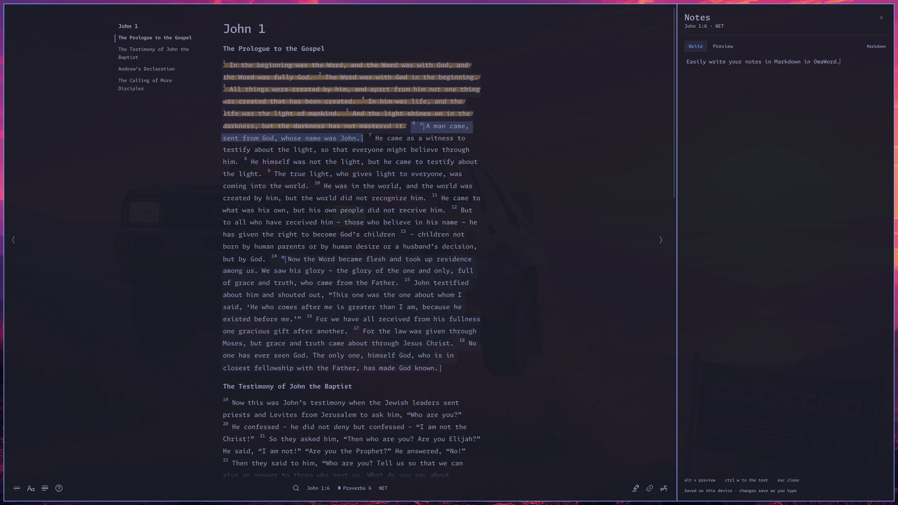
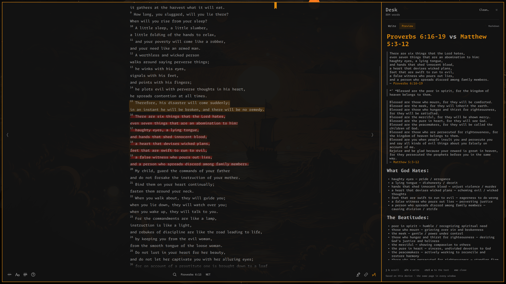
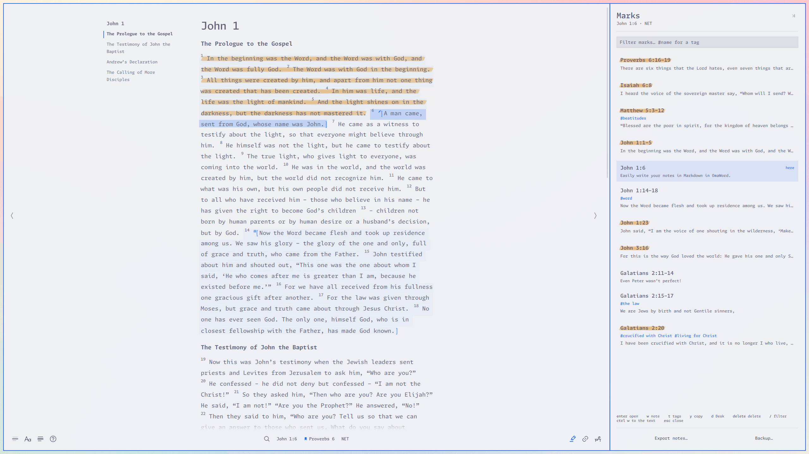
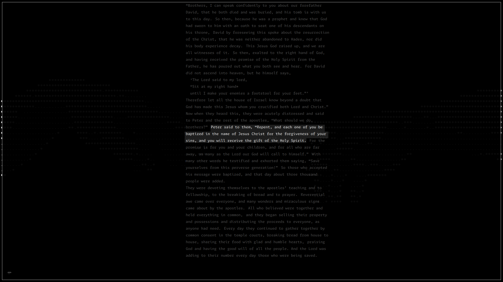

# OmaWord

[](https://github.com/tcballard/omarchy-badges)

A minimal, keyboard-first Bible reader built with Qt Quick and C++ that follows your Omarchy theme, system font, and desktop corners. Read offline, highlight and tag passages, and keep Markdown notes alongside the text.


<p>
  
  
  
  
</p>
<p align="center">
  
  
</p>

Screenshots show the [NET](https://netbible.org) Bible®, quoted by permission (see [Credits](#credits)).

## Install

OmaWord is built for [Omarchy](https://omarchy.org) and assumes its Hyprland session, theme, and fonts.

```sh
sudo pacman -S --needed base-devel qt6-declarative libpipewire
git clone https://github.com/bradenr402/omaword.git
cd omaword
bin/build
bin/install
```

Launch **OmaWord** from the application launcher, or run `omaword`. Choose **Add version** to install an English Bible from AO Lab (NET, KJV, BSB, and more) or import AO standard complete JSON; after that, everything works offline. The searchable catalog is bundled; manual refreshes persist across restarts and updates. Other languages are discoverable but not yet supported.

To update, `git pull`, run `bin/build` and `bin/install` again, and close every OmaWord window. To install it as an Arch package instead, run `makepkg -si` in `packaging/`.

## Shortcuts

- `j` `k` step through verses, `h` `l` through chapters, and `ctrl k` goes to any passage (`jn316` works).
- `shift V` selects verses and `v` characters (so does a drag), Vim style; `x` highlights, `w` writes a note, `t` tags, `y` copies, and `u` undoes.
- `/` finds in the chapter, `ctrl /` searches the Bible, and `ctrl space` runs any command.
- `shift M` lists your marks, `shift S` shows cross-references, and `d` adds the passage to the Desk, a study page (`shift D`).
- `shift R` places your ribbon and `r` returns to it; `[` and `]` step back and forward through the passages you jumped to.
- `f` dims all but the current verse, `alt b` shows the whole book, and `ctrl ,` opens Reading settings.
- `?` lists every key, searchable; `enter` there performs it.

<details>
<summary>Every key</summary>

<!-- shortcuts:start -->

Press `?` in the app for the full, searchable list; `enter` there performs the selected action.
Generated from the action catalog by `bin/shortcuts`; alternatives are separated by ·.

### Navigate

- `k` · `↑`: Previous verse
- `j` · `↓`: Next verse
- `4j`: Repeat a verse motion by a count
- `20gg`: Go to verse number
- `gg` · `home`: Select chapter beginning
- `shift G` · `end`: Select chapter end
- `ctrl u`: Previous 5 verses
- `ctrl d`: Next 5 verses
- `ctrl b` · `pgup`: Previous 10 verses
- `ctrl f` · `pgdn`: Next 10 verses
- `zz`: Center current verse
- `zt`: Scroll current verse to top
- `zb`: Scroll current verse to bottom
- `h` · `←`: Previous chapter
- `l` · `→`: Next chapter
- `gB`: Previous book
- `gb`: Next book
- `gc`: This book's chapters
- `{`: Previous heading or chapter top
- `}`: Next section heading
- `gM`: Previous mark (highlight, note, or tag)
- `gm`: Next mark (highlight, note, or tag)
- `gN`: Previous note
- `gn`: Next note
- `gT`: Previous tagged passage
- `gt`: Next tagged passage

### History

- `[`: Back to the previous jump
- `]` · `mouse forward`: Forward to the next jump
- `-`: Swap with the previous jump
- `shift R`: Place the ribbon here
- `r`: Back to the ribbon
- `ctrl shift R`: Remove the ribbon
- `mouse back`: Back a jump, back to the palette's books, or close the open panel

### Select

- `click`: Select verse
- `shift click`: Select a range
- `shift V`: Toggle visual selection
- `v`: Select characters (Vim charwise visual)
- `drag` · `double click`: Select the characters dragged over, or the word double clicked
- `h` · `l`: Characters: left, right (across verses)
- `w` · `b` · `e` · `ge`: Characters: by word
- `shift W` · `shift B` · `shift E`: Characters: by WORD (no spaces)
- `(` · `)`: Characters: by sentence
- `j` · `k`: Characters: by line
- `0` · `^` · `$`: Characters: line start, first ink, end
- `gg` · `shift G`: Characters: chapter start, end
- `iw` · `aw` · `is` · `as`: Characters: word, sentence objects
- `y` · `ctrl c`: Characters: copy quotation
- `shift Y` · `ctrl shift C`: Characters: copy plain text
- `esc`: Characters: leave
- `shift J` · `shift ↓`: Extend to next verse
- `shift K` · `shift ↑`: Extend to previous verse
- `o`: Swap the selection's ends
- `m`: Select the whole mark around the selection
- `gv`: Select the earlier range of verses again

### Search

- `/`: Find in chapter
- `n`: Next search match
- `shift N`: Previous search match
- `ctrl /`: Search Bible
- `alt a`: Bible search: every version or the one you read
- `ctrl ↓` · `ctrl ↑`: Bible search: next book, previous book

### Annotate

- `x`: Highlight selection
- `w`: Write a note
- `gi`: Write on in the note last written
- `t`: Tag passage
- `d`: Add to Desk
- `ctrl shift D`: Clean Desk
- `u` · `ctrl z`: Undo a mark, note, or tag change
- `ctrl shift Z` · `ctrl r`: Redo the change undone
- `ctrl t`: Manage tags
- `enter`: Manage tags: rename the chosen tag
- `delete`: Manage tags: delete a tag
- `ctrl m`: Manage tags: choose a tag to merge into
- `backspace`: Manage tags: back to the picker (empty filter)
- `[[`: Suggest a passage to link (in a note)
- `alt enter`: Open the passage or web link at the cursor (in a note or the Desk)
- `ctrl click`: Open the passage or web link clicked (in a note or the Desk)
- `alt v`: Switch a note or the Desk between Write and Preview
- `ctrl s`: Note or Desk changed in another window: save my draft
- `ctrl shift S`: Note or Desk changed in another window: use the saved text
- `ctrl ↓`: From a note to its Linked from list (esc returns)
- `esc`: Close a note or the Desk, the draft saved (its link suggestions first)
- `ctrl z` · `ctrl shift Z` · `ctrl y`: Undo, redo typing (in a note or the Desk)

### Copy

- `y` · `middle click`: Copy passage as quotation
- `ctrl c`: Copy selected text as quotation (else the passage)
- `shift Y`: Copy passage as plain text
- `gy`: Copy only the passage's reference
- `ctrl shift C`: Copy selected text as plain text (else the passage)
- `menu` · `shift F10` · `right click`: Open context menu

### Panels

- `shift M`: Marks panel
- `shift D`: Open Desk
- `shift S`: See also panel
- `ctrl w`: Keyboard to the open side panel, or back to the text
- `i`: Peek at the verse's footnotes
- `c`: Compare the selection across versions
- `o`: Compare: open the highlighted version in a window beside, following this one

### Palettes and windows

- `ctrl k`: Navigate to a passage
- `ctrl h`: History
- `ctrl space`: Open commands
- `space`: Resume last palette
- `ctrl ,`: Reading settings
- `ctrl v`: Switch version
- `shift C`: Open a version beside this window
- `y` · `shift Y`: Copy the highlighted version's text (Versions, comparing)
- `?`: Keybindings
- `ctrl n`: New window
- `ctrl i`: Add version from Versions
- `ctrl enter`: Open the highlighted version beside this window (Versions)
- `enter`: Add version: install the highlighted version
- `shift enter`: Add version: its Details & Attribution
- `ctrl i`: Add version: import AO complete JSON
- `ctrl r`: Refresh the AO catalog (Add version)
- `backspace`: Back a step in Remove version (Versions)
- `ctrl shift I`: Re-import the highlighted version (Versions)
- `delete`: History: remove a passage
- `shift delete`: History: clear it

### Reading

- `f`: Focus mode
- `alt n`: Show verse numbers
- `alt h`: Show headings
- `alt o`: Chapter outline
- `alt b`: Whole book
- `alt w`: Show notes in margin
- `alt j`: Highlight words of Jesus
- `alt l`: Layout
- `alt shift L`: Default layout (Paragraph)
- `alt s`: Sound effects
- `alt m`: Animations
- `ctrl =`: Larger text
- `ctrl -`: Smaller text
- `ctrl 0`: Reset text size
- `ctrl alt =`: Increase line height
- `ctrl alt -`: Decrease line height
- `ctrl alt 0`: Reset line height
- `esc`: Dismiss current panel or selection

### Lists

- `j` · `↓`: Next item
- `k` · `↑`: Previous item
- `gg` · `home`: First item
- `shift G` · `end`: Last item
- `ctrl d`: Down 5 items
- `ctrl u`: Up 5 items
- `ctrl f` · `pgdn`: Down 10 items
- `ctrl b` · `pgup`: Up 10 items
- `enter`: Open item
- `y`: Copy item as quotation
- `shift Y`: Copy item as plain text
- `d`: Add item to Desk
- `delete` · `backspace`: Remove item
- `t`: Edit the item's tags (Marks, See also)
- `w`: Write the item's note in place (Marks)
- `/`: Filter the list, #name for a tag (Marks with more than 10 items, See also)

### Commands only

- Add version
- Remove version
- Export your marks as Markdown
- Back up your marks
- Restore a backup of your marks
- Clear History
- Stop following the window beside
- Disable / Enable History
- About & Attribution

### Aliases

These also work, but stay out of the in-app list:

- `20G` (Go to verse number): Vim's go-to-line.
- `F6` (Keyboard to the open side panel, or back to the text): the desktop's key for moving between a window's panes.
- `ctrl shift P` (Open commands): the command palette key in VS Code and its kin.
- `F1` (Keybindings): the help key in most desktop apps.
- `ctrl +` (Larger text): the zoom-in key in most apps (shift = on many layouts).

<!-- shortcuts:end -->

</details>

Read in the Paragraph, Verse, or Block layout; **Aa** in the footer sets the text size and line height. Wide windows can add a chapter outline on the left and your notes in the right margin.

Bible search (`ctrl /`) finds the verses holding all your words, and "an exact phrase" even across verses; `alt a` searches every version you installed. A query in slashes (`/lov(e|ed) the/`) is a regular expression, as every find in the chapter (`/`) is. Case works as in Neovim, words and all: lowercase ignores it, a capital matches it, and `\c` / `\C` force either.

Notes are Markdown with passage links: `[[` suggests a passage, and `alt v` previews the note (an image shows as a link to it, so nothing loads from the web). **Marks** gathers every highlight, note, and tag; **See also** follows your reading with cross-references, parallel passages, and the passages you tagged alike. `c` compares a passage across your versions, and `shift C` opens another version beside yours, the two scrolling together.

The **Desk** is one Markdown page shared by every window: `d` quotes the passage you read on it, with a link back, and you write around the quotations.

Bible versions, marks, the Desk, and History stay on this device, in `~/.local/share/omaword/`. Commands back up your marks, restore them, and export them as Markdown.

## From a terminal

```sh
omaword "John 3:16"              # a new window at a passage
omaword open jn316 --here        # the window you were reading, at a passage
omaword lookup                   # look up a passage in a small window
omaword quote ps23 -t KJV        # print a passage as a quotation
omaword search "living water"    # search the version you read
omaword link jn316               # print an omaword: link to a passage
```

`quote`, `search`, and `link` print without opening a window. Links like `omaword:John%203:16` (or `omaword:jn316?translation=KJV`) open where you were reading, from `xdg-open` or a browser. `omaword help` lists every command and `man omaword` has the manual; `bin/install` adds bash completion, and `omaword completion zsh` (or `fish`) prints the others.

`omaword lookup` suits a key binding; in Omarchy, add one, and a rule to float and center the window (it can be resized), to `~/.config/hypr/bindings.lua`:

```lua
o.bind("SUPER + ALT + B", "Look up a passage", "omaword lookup")
o.window({ class = "^omaword$", title = "^Look up · OmaWord$" }, { float = true, center = true, no_anim = true })
```

## Requirements

- Omarchy (Hyprland on Arch Linux)
- `base-devel` (C++17 compiler, `make`, `pkg-config`) and `qmake6`, provided by `qt6-base`
- Qt 6: `qt6-base`, `qt6-declarative`, and `qt6-wayland`
- `fontconfig` and `libpipewire` (sound effects)

Omarchy already provides most of these; the install command above adds the rest.

## Credits

Bible text has its own copyright and attribution, shown in About & Attribution. The screenshots quote the NET Bible, under its own permission rather than the MIT license:

> Scripture quoted by permission. Quotations designated (NET) are from the NET Bible® copyright ©1996, 2019 by Biblical Studies Press, L.L.C. http://netbible.com All rights reserved.

Cross-references come from each version's source and from "Cross references" by [OpenBible.info](https://www.openbible.info/labs/cross-references/), licensed [CC BY 4.0](https://creativecommons.org/licenses/by/4.0/) and converted for OmaWord (entries without positive votes dropped, duplicates merged); that data, `resources/crossrefs.bin`, stays under CC BY 4.0. The application code is [MIT licensed](LICENSE).

Found a problem or have an idea? [Open a GitHub issue](https://github.com/bradenr402/omaword/issues), or a pull request. Agent contributions are welcome. See [ARCHITECTURE.md](ARCHITECTURE.md), [tests/README.md](tests/README.md), and [AGENTS.md](AGENTS.md) for development.
